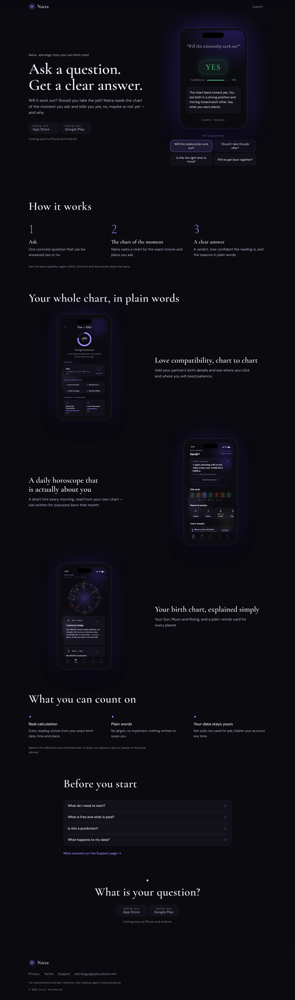
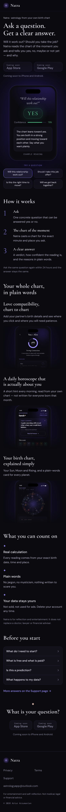
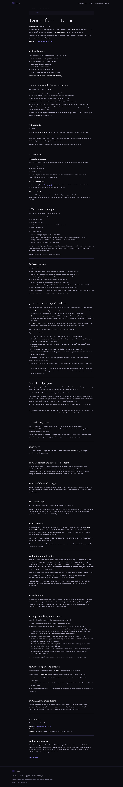
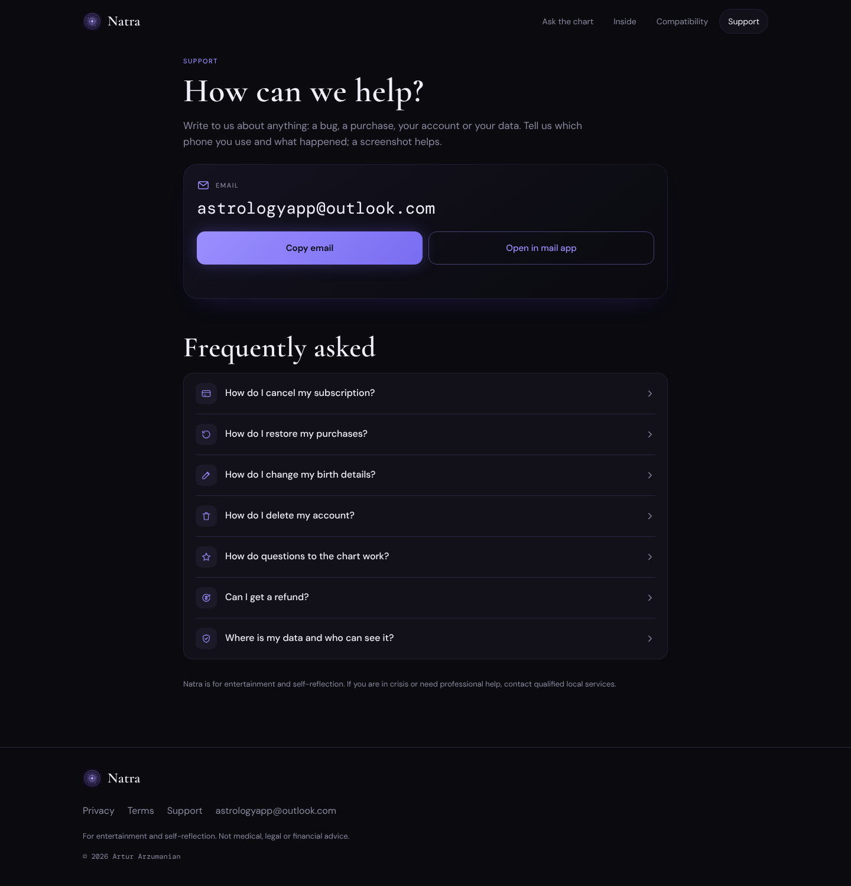
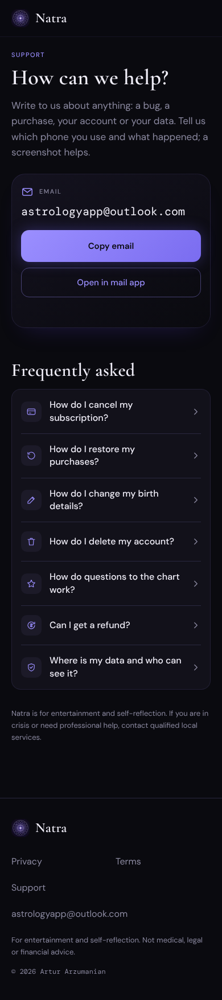
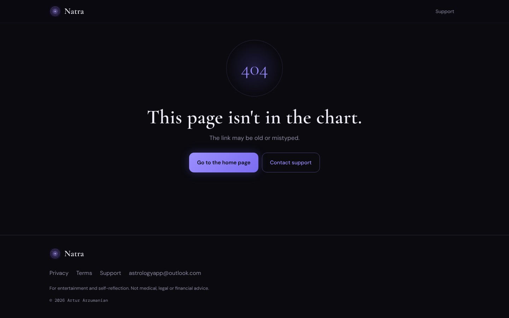
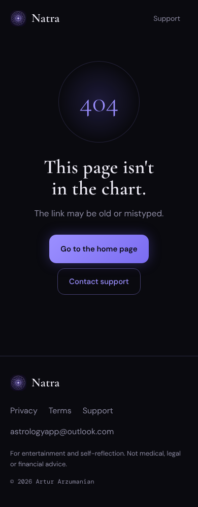
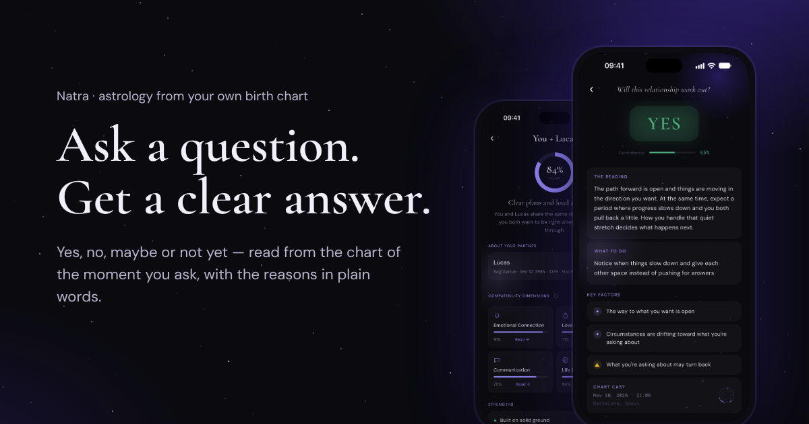

# 30 — Сайт Natra: лендинг, Privacy, Terms, Support

Дата: 2026-11-05. Репозиторий: `kgrigoryan0220/natra-landinig`, ветка `claude/new-session-zy2pvy`.

## Итог

- Готовы все пять страниц: `/`, `/privacy`, `/terms`, `/support`, `/404`. Язык — английский, структура готова к локалям `/ru/` и другим.
- Сборка одной командой `npm run build`, результат — папка `dist/` (1,6 МБ). Локально всё открывается через `npx serve dist`.
- Lighthouse, главная, мобильный режим: **Performance 98 · Accessibility 100 · Best Practices 100 · SEO 100**.
- Privacy и Terms на сайте совпадают с `.md` слово в слово: это проверяет `npm run check`, исходные файлы скопированы побайтно.
- Без cookies, аналитики, трекеров и сторонних скриптов. Шрифты лежат в проекте, внешних запросов нет.
- Favicon, `apple-touch-icon` и иконки 192/512 сделаны из иконки приложения 1024×1024 (`src/assets/icon/app-icon.png`). Она пришла в чат в WebP, поэтому сжата с потерями. Если нужен исходник байт в байт, положите оригинальный `natra_icon_1024.png` на её место и пересоберите сайт.

## Скриншоты

Все в `reports/30-site/`, по одному на каждую страницу в двух ширинах: десктоп 1440 и телефон 390.

| Страница | Десктоп 1440 | Телефон 390 |
|---|---|---|
| Лендинг |  |  |
| Privacy |  |  |
| Terms |  |  |
| Support |  |  |
| 404 |  |  |

Картинка для соцсетей (Open Graph / Twitter, 1200×630): 

## Стек и почему

- **Чистый HTML/CSS и собственный скрипт сборки на Node.js** (`scripts/build.mjs`) без фреймворка. Страниц пять, и все они простые. Astro или Eleventy добавили бы десятки зависимостей и свои правила, а здесь сборка читается за десять минут.
- Два пакета: `marked` (документы из `.md` → HTML) и `sharp` (скриншоты в AVIF и WebP в нескольких размерах плюс JPEG как запасной вариант, favicon и иконки).
- Весь JavaScript на сайте — около 40 строк для кнопки «Copy email» на странице поддержки.
- Анимация одна: медленный дрейф звёздной пыли (слой сдвигается за 260 секунд, только через `transform`). При `prefers-reduced-motion` она выключается.
- Шрифты те же, что в приложении (по `pubspec.yaml`): **Cormorant Garamond** для заголовков, **DM Sans** для текста, **DM Mono** для дат и данных. Это файлы woff2 с латиницей, лицензии OFL лежат рядом.
- Палитра и компоненты взяты из дизайна приложения (прототип `Astro_App_current_standalone`, редизайн `.mx`), подробности — в разделе «Редизайн v2» ниже. Зелёный, жёлтый и красный встречаются только там, где есть оценка: вердикт, недельная полоса и плашки факторов.
- Заголовки безопасности в `dist/_headers`: CSP только `'self'`, `X-Frame-Options` и другие. Их понимают Cloudflare Pages и Netlify.

## Тексты лендинга (en) — на вычитку

Все тексты лежат в одном файле: `content/en/site.json`. Ниже то же самое, собрано из него скриптом.

#### Meta
- **Title:** Natra — Birth Chart, Horoscope & Love Compatibility
- **Description:** Natra is personal astrology built on your birth chart: a daily horoscope about you, love compatibility, a portrait of who you are and clear answers to yes-or-no questions. Coming to iPhone and Android.

#### 1. Hero
- Eyebrow: Birth chart · Horoscope · Compatibility
- H1: Natra
- Promise: A personal astrologer that explains, not scares.
- Lead: Your date, time and place of birth become your birth chart. Natra turns it into clear daily hints, a portrait of who you are, love compatibility and answers to the questions on your mind.
- Buttons: «Coming soon · App Store», «Coming soon · Google Play» (screen readers: «Coming soon to the App Store», «Coming soon to Google Play»)

#### 2. Ask the chart
- Eyebrow: Ask the chart
- H2: Ask a question. Get a clear answer.
- Lead: Will this relationship work out? Should you take the job? Type a yes-or-no question. Natra casts the chart of the minute you ask and reads it for you: a verdict, how confident the reading is, what it means in plain words and the key factors behind it.
- Step 01 — **Your question.** One concrete thing: a person, an offer, a move. Ask it so it can be answered yes or no. Data line: `“Will this opportunity work out for me?”`
- Step 02 — **The chart of the moment.** The chart is cast for the date, time and place where you ask. That moment is where the answer comes from. Data line: `17 MAY 2026 · 14:30 · NEW YORK`
- Step 03 — **The significators.** Natra finds the planets that stand for you and for what you asked about, then reads their dignity, combustion and aspects. Data line: `DIGNITY · COMBUSTION · ASPECTS`
- Step 04 — **The verdict.** Yes, no, maybe or not yet, with a confidence score, a short reading, what to do next and the factors that shaped it. Data line: `YES · 78%`
- Footnote: The same question within 24 hours gets the same answer. Some topics, like health or death, are not for the chart.

#### 3. Three layers
- Eyebrow: Three layers
- H2: Start with today. Go as deep as you like.
- Lead: Everything in Natra comes from one calculation: your birth chart. You decide how far to read.
- 01 · Today — **A daily ritual.** A short hint on Home every day. With Natra Pro, open the full forecast — mood, relationships, work, money and your best hours — look ahead with the week view and see which transits are active. Tags: Hint of the day · This week · Transits
- 02 · Your chart — **Your birth chart, explained simply.** The wheel of your natal chart and a card for every planet and point: the sign, the house and what it says about you, in everyday words. Start with your Sun, Moon and Rising. Tags: Chart wheel · Big three · Every placement
- 03 · Deeper — **When you want the whole story.** The full portrait — your main themes, love, work, talents and shadow side. Compatibility with the people in your life. And questions to the chart when you need a clear answer. Tags: Full portrait · Compatibility · Questions

#### 4. Love compatibility
- Eyebrow: Love compatibility
- H2: Chart to chart, not sign to sign.
- Lead: Add your partner's birth details and see how your two charts meet. This is synastry: your charts read together, not just two zodiac signs side by side.
- **Your match.** One percentage with a short summary of you as a pair.
- **Areas and dimensions.** Emotional connection, love and romance, communication and a shared future — where the bond is strong and where it has room to grow.
- **Your partner's chart.** Their details in one place, and their full chart a tap away.

#### 5. FAQ
- Eyebrow: Questions
- H2: Before you start
- **What do I need to start?** Your date of birth, and ideally the time and place. The time is optional, but with it Natra can work out your Rising sign and houses.
- **What is free and what is paid?** Your chart and a short daily hint come at no cost. Natra Pro, a subscription, unlocks the full daily forecast, the week view and transits. The full portrait, compatibility reports and packs of questions are one-time purchases. Prices are shown in the app before you buy.
- **Is this a prediction?** No. Natra is for reflection and entertainment. It shows what your chart describes and leaves the decisions to you. It is not medical, legal or financial advice.
- **What happens to my data?** Your birth details are used to calculate your chart and readings. Your data is not sold and not used for advertising, and you can delete your account in the app at any time. The details are in the Privacy Policy.
- Link: More answers on the Support page →

#### 6. Closing
- H2: Your chart, read in plain words.
- Text: Natra is coming to iPhone and Android.

#### Footer
- Privacy · Terms · Support · astrologyapp@outlook.com
- For entertainment and self-reflection. Not medical, legal or financial advice.
- © 2026 Artur Arzumanian

#### Image alt texts
- Home: Natra Home screen: today's guidance, a colour-coded week and planets in motion.
- Chart: Natra chart screen: a natal chart wheel for 12 Oct 1994, 14:42, Berlin, and a card for Sun in Gemini in the 9th house.
- Ask: Natra answer screen: the question “Will this opportunity work out for me?”, a YES verdict with 78% confidence, the reading and key factors.
- Compatibility: Natra compatibility screen: You + Alex, a 78% match, areas of connection and compatibility dimensions.

#### Support page
- **Title:** Support — Natra astrology app
- **Description:** Help with Natra: contact support, cancel a subscription, restore purchases, edit birth details, delete your account, refunds and how questions to the chart work.
- H1: How can we help?
- Lead: Write to us about anything: a bug, a purchase, your account or your data. Tell us which phone you use and what happened; a screenshot helps.
- Buttons: Copy email · Open in mail app
- **How do I cancel my subscription?**
  Subscriptions are managed by Apple or Google, so you cancel them in your store account, not inside Natra.
  **iPhone:** open Settings → [your name] → Subscriptions, choose Natra and tap Cancel Subscription.
  **Android:** open Google Play, tap your profile icon, then Payments & subscriptions → Subscriptions, choose Natra and tap Cancel subscription.
  Cancel at least 24 hours before the current period ends to avoid the next charge. Deleting the app does not cancel a subscription, and neither does deleting your Natra account.
- **How do I restore my purchases?**
  Sign in to the same Natra account you used when you bought, open Profile and tap Restore purchases. On a new phone, use the same Apple ID or Google account as before.
- **How do I change my birth details?**
  Open Profile and edit your birth details there: date, time and place of birth. Your chart and readings are based on these details.
- **How do I delete my account?**
  Open Profile → Delete account. This permanently removes your Natra account and the data linked to it: birth details, portrait, compatibility reports, questions and answers. Question credits and compatibility reports are deleted too and cannot be restored. Deletion cannot be undone.
  Deleting your account does not cancel an active subscription — cancel it in your store account first. Purchases made through Apple or Google stay in your store account.
- **How do questions to the chart work?**
  Ask about one concrete thing in a yes-or-no form. Natra casts the chart of the moment and place you ask and answers yes, no, maybe or not yet, with a confidence score and the key factors.
  If you ask the same question again within 24 hours, you get the same answer: the chart of the moment does not change because you ask twice.
  The chart does not answer questions about death, health and similar topics. For those, please talk to a qualified professional.
- **Can I get a refund?**
  All payments go through Apple or Google, so refunds are handled by them under their rules:
  - **App Store:** [request a refund from Apple](https://support.apple.com/en-us/118223) - **Google Play:** [request a refund from Google](https://support.google.com/googleplay/answer/2479637)
  If something went wrong with a purchase, write to us as well — we will help you sort it out.
- **Where is my data and who can see it?**
  Your account, birth details and readings are stored on our servers and with the providers that help us run Natra; they process data only for us. Your data is not sold and not used for advertising. The full list of what is collected, where it is stored and your rights is in the [Privacy Policy](/privacy).
- Disclaimer: Natra is for entertainment and self-reflection. If you are in crisis or need professional help, contact qualified local services.

#### 404
- This page isn't in the chart. The link may be old or mistyped. Buttons: Go to the home page · Contact support
## Скриншоты приложения: что взято и что заменить

Исходники пришли в чат: пять экспортов 976×2000, уже в рамке телефона. Экраны из рамок я вырезал (894×1932): теперь рамка рисуется в CSS, и сырые кадры из `raw2/` можно подкладывать одним файлом с тем же именем.

| Слот (`src/assets/screenshots/`) | Источник | Где на сайте | Заменить после пересъёмки |
|---|---|---|---|
| `home.png` | Home: Today's guidance, This week, Planets in motion | Hero, левый телефон | Да, плановая замена. На кадре есть кнопка «Read full forecast»: если в текущей версии она ведёт за пейвол, лучше взять кадр без неё |
| `chart-wheel.png` | Your chart: колесо, карточка Sun · Gemini | Hero, центр; картинка для соцсетей | **Да, в первую очередь.** На исходнике была ссылка «Ask AI →», которой в приложении нет. Я закрасил её цветом карточки, а новый кадр её снимет совсем |
| `ask-verdict.png` | Ask: вердикт YES 78 %, The reading, Key factors | Блок «Ask the chart»; картинка для соцсетей | Да, если экран вердикта изменился |
| `compatibility.png` | You + Alex: 78 % match, сферы и измерения | Hero, правый телефон | Да, если экран изменился |

**Не использованы:**
- «Your Full Portrait / The Sage / The Jester»: архетипов в нынешнем портрете нет, это прямо сказано в задании.
- Кадров «построение карты», «экран вопроса» (ввод) и «короткий портрет: Солнце / Луна / Асцендент» в присланных файлах не было. Когда появятся, их можно добавить новыми слотами: строка в `SCREEN_SLOTS` в `scripts/build.mjs` и вызов `phone(...)` в `src/templates/pages.mjs`.

После замены выполните `npm run build`, а для картинки соцсетей ещё и `npm run og`.

## Lighthouse

Lighthouse 12.8.2, headless Chromium, сайт отдавался через `npx serve dist`.

| Страница | Режим | Performance | Accessibility | Best Practices | SEO |
|---|---|---|---|---|---|
| `/` | мобильный | **98** | **100** | **100** | **100** |
| `/` | десктоп | 100 | 100 | 100 | 100 |
| `/privacy` | мобильный | 100 | 100 | 100 | 100 |
| `/terms` | мобильный | 100 | 100 | 100 | 100 |
| `/support` | мобильный | 100 | 100 | 100 | 100 |
| `/404` | мобильный | 100 | 100 | 100 | 66 — так задумано: `noindex` |

Главная, мобильный режим (после редизайна v2): **98–99 / 100 / 100 / 100**, FCP 1,2 с · LCP 2,2 с · TBT 0–10 мс · CLS 0. Полный отчёт: `reports/30-site/lighthouse-home-mobile.html`.

Остались два мелких замечания. «Cache policy» появляется потому, что `serve` не читает `_headers`: на Cloudflare ассеты кешируются на год. «Render-blocking» — это один CSS-файл на 6 КБ (gzip). Встроить его в HTML мешает строгий CSP.

## Выкладка — кратко

1. `npm install && npm run build`.
2. Cloudflare → Workers & Pages → Create → Pages → **Upload assets** → перетащить папку `dist`. Другой вариант — **Connect to Git**: build command `npm run build`, output `dist`.
3. Custom domains → добавить домен, затем вписать его в `site.config.mjs` → `SITE_URL`, пересобрать и выложить заново.
4. Вставить ссылки: Privacy → `https://<домен>/privacy`, Terms → `/terms`, Support → `/support`, Marketing / Website → главная, Delete account URL (Google Play) → `/support#delete-account`.

Подробная пошаговая инструкция и таблица «какое поле → какая ссылка» — в `README.md`.

## Проверки

- `npm run check`: Privacy (2172 слова) и Terms (1998 слов) совпадают с `.md`. Проверка независимая: markdown-разметку скрипт вычищает сам, без `marked`, а номера пунктов в нумерованных списках тоже сверяются. Скрипт проверил на порче: подменённое слово и сбитую нумерацию он ловит.
- Кнопка «Copy email» копирует адрес, сообщение «Email copied» озвучивается через `aria-live`. Без доступа к буферу обмена адрес выделяется. Сам адрес — обычный текст, его можно выделить и скопировать вручную.
- В консоли нет ошибок, `id` не повторяются. Первый Tab ведёт на «Skip to content». При `prefers-reduced-motion` анимация выключена.
- На всех страницах есть `title`, `description`, canonical, Open Graph, Twitter-карточка и `apple-itunes-app` (app-id 6812511817). На главной — JSON-LD `MobileApplication` без рейтингов, отзывов и цен. Есть `sitemap.xml` (даты документов взяты из «Last updated») и `robots.txt`.

## Решения, принятые за владельца

1. **Обещание в hero** оставил из кейс-стади: «A personal astrologer that explains, not scares.» Лучше в этом голосе не нашлось.
2. **Блок «Ask the chart»** опирается на формулировки из `us.md`: «yes, no, maybe or not yet», «how confident», «what to do next», «key factors». Третий шаг: «Natra finds the planets that stand for you…» — планеты здесь символы, а не действующие лица. Вердикт выносит Natra и «chart of the moment».
3. **Natra Pro упомянута по имени** в блоке «Today» и в FAQ «What is free and what is paid?»: без этого нечестно описывать, что входит в бесплатную часть. Цен нет. Слова «free» в заголовках нет, оно встречается только в вопросе FAQ.
4. **Что бесплатно.** Фраза «Your chart and a short daily hint come at no cost» опирается на `us.md` (подсказка на Home каждый день, полный прогноз с Pro) и на то, что колесо и Солнце / Луна / Асцендент в задании названы кадрами без замков. Владелец подтвердил: колесо карты и подсказка дня бесплатны.
5. **FAQ поддержки.** Названия пунктов меню взяты из юридических текстов: «Profile → Delete account», «Restore purchases», «edit your profile and birth details». Английской локали приложения у меня не было, поэтому точную подпись кнопки редактирования данных рождения я не знаю. В тексте стоит «Open Profile and edit your birth details there» без названия кнопки, поэтому он верен при любой подписи. Если появится точная английская подпись, её можно вписать в `site.json`.
6. **Пути отмены подписки** — стандартные для iOS и Google Play на ноябрь 2026. Ссылки на возвраты ведут на официальные страницы: Apple — https://support.apple.com/en-us/118223, Google — https://support.google.com/googleplay/answer/2479637.
7. **На что карта не отвечает** — «death, health and similar topics», как в задании. Если в приложении список шире (например, юридические вопросы), его можно дописать в `site.json`.
8. **Кнопки сторов** сделаны в стиле сайта: пунктирная рамка, «COMING SOON · App Store». Логотипов Apple и Google нет. Как подключить официальные значки, написано в README.
9. **На кадре колеса карты закрашена ссылка «Ask AI →»** (см. таблицу скриншотов), потому что такой функции в приложении нет.
10. **Адреса страниц без `.html` и без слеша** (`/privacy`): файлы собираются как `privacy.html`, и Cloudflare Pages, Netlify и `serve` отдают их по чистым адресам. Канонические ссылки сделаны так же.
11. **`dist/` не коммитится**: папку собирает `npm run build` локально или Cloudflare при подключении через GitHub.
12. **Работа в облачной сессии.** Задание писалось под `~/Desktop/natra-site`, но эта сессия работает в облаке с репозиторием `kgrigoryan0220/natra-landinig`. Исходники пришли в чат. Владелец разрешил push в ветку `claude/new-session-zy2pvy`, создание ветки `main` и draft PR. Деплоя и регистраций в сервисах не было. Отчёт и скриншоты лежат в `reports/` этого репозитория, а не в `~/Desktop/natra_night/reports/`: оттуда их можно скопировать.

## Редизайн v2 — на компонентах приложения

Владелец прислал дизайн приложения: интерактивный прототип в HTML, 5 вкладок, шторки, онбординг. В нём два поколения стилей:
- Home и Chart — старые: DM Serif Display и Inter;
- экраны с пометкой `.mx` — Ask, Match, полный портрет, шторки. Они переведены на Cormorant, DM Sans и DM Mono, то есть на шрифты из `pubspec.yaml`.

Лендинг собран на языке `.mx` как на актуальном.

**Токены (из `.mx`):**
- фон `#0A0A0F`;
- плашки `#12111A`, при наведении `#15131F`;
- дорожки и поля `#1C1A28`;
- обводка `rgba(155,143,255,.12)`;
- акцент `#9B8FFF`, свечение `#5E3EF3`;
- тёплые метки `#FFD5C5`;
- текст `#F0EEF8` и `#8B89A0`;
- семантика `#4CAF7D` / `#E8A838` / `#E05555`;
- радиусы 12 / 16 / 24.

**Типографика:**
- Cormorant 600 — заголовки;
- Cormorant italic 300 — обещание и вопросы;
- DM Sans 500, 11 px, капс с разрядкой .14em — метки (`mx-micro`);
- DM Mono — даты и данные.

**Компоненты на лендинге — вёрстка, а не картинки:**

| Блок сайта | Компонент приложения |
|---|---|
| Ask the chart, шаг 1 | пузыри популярных вопросов (`ask-chip`, через один слева и справа) |
| шаг 2 | карточка «Chart cast» (`ask-chart-moment`) |
| шаг 3 | плашки «Key factors» (`ask-factor`) |
| шаг 4 | бейдж вердикта YES и полоса уверенности (`ask-answer-badge`, `ask-conf-bar`) |
| Three layers, Today | карточка «Today's guidance» со свечением и ✦, недельная полоса с легендой, транзит с бейджем STRONG |
| Your chart | карточка планеты (`portrait-card`: «SUN · GEMINI», «9th House») |
| Deeper | карточки пар «You + Alex 78 %» (`mx-mcard`) |
| Compatibility | кольцо совпадения (`mx-ring`), «Strong Connection», «Their info», сферы связи (`mx-conn`), измерения с полосками (`mx-dim`, `mx-bar`) |
| FAQ лендинга | аккордеон профиля (`faq-item`, шеврон поворачивается) |
| Support | меню в стиле профиля (`settings-row` с иконкой в квадрате), основная кнопка — градиент приложения (`mx-btn-primary`), второстепенная — контур (`mx-btn-secondary`) |
| 404 | круг «void» из экрана «вопрос нельзя прочитать» (`ask-void-icon`) |
| Документы | пилюля с датой в DM Mono, оглавление и таблицы на плашках |

**Что изменилось помимо стилей:**
- Скриншоты: в hero теперь Home, колесо карты и совместимость, а экран вердикта — в блоке «Ask the chart». Блок совместимости собран из компонентов, без скриншота.
- Иконки поддержки — простые линейные SVG. В прототипе там эмодзи, но эмодзи как маркеры на сайте не используем.
- Из прототипа **не** перенесено то, что противоречит заданию: «Ask AI», «The stars will read the chart», цены и зачёркнутые цены, эмодзи в вопросах.
- **FAQ поддержки.** Подписи пунктов взяты из экрана профиля в прототипе: «Edit birth data», «Restore Purchases», «Delete Account». Это прототип, а не код приложения. Если в приложении подписи другие, поправьте `content/en/site.json`.

**Тексты демо-компонентов** (все в `content/en/site.json` → `demo`, это примеры интерфейса):
- Popular questions: «Will this relationship work out?», «Should I take this opportunity?», «Is this the right time to move?»
- Chart cast: «May 17, 2026 · 14:30», «New York, USA»
- Key factors: «Both significators in dignity — strong ability to act»; «Ascendant ruler combust — some details may be hidden from view right now»
- Verdict: «YES», «Confidence 78%»
- Today's guidance: «A quiet morning will reveal what a busy one would have hidden.» «Based on Mercury trine natal Moon»; транзит «Mercury trine natal Moon — Clarity in feelings · communication flows easily — STRONG»
- Your chart: «Sun · Gemini · 9th House — Curious by design — Your identity moves through questions, not answers. You're at your most alive when something new is on the table.»
- Deeper: «You + Alex · Dec 14, 1996 · New York · 78%», «You + Sofia · Aug 21, 1998 · Paris · 91%»
- Compatibility: «78% match — Strong Connection — A rare share of values with real, workable friction to grow through.» Their info: «Alex · Sagittarius · Dec 14, 1996 · New York · View chart →». Areas: Emotional depth, Shared humor, Creative synergy, Mutual ambition. Dimensions: Emotional connection 85%, Love & romance 61%, Communication 72%, Shared future 66%.

Прежние тексты лендинга выше не менялись, кроме строк данных под шагами «Ask the chart»: их заменили компоненты.

## Правки после просмотра (v2.1)

- **FAQ на главной и в Support — одна и та же гармошка.**
  - Вопрос раскрывается и закрывается плавно: анимация высоты и прозрачности 0,32 с, шеврон поворачивается.
  - Открыт только один вопрос: при открытии другого предыдущий плавно закрывается.
  - При `prefers-reduced-motion` анимации нет.
  - Без JavaScript работает обычный `
`.
- **Support без якорей.** Список-оглавление и отдельные карточки ответов заменены одной гармошкой с иконками. Прямые ссылки сохранены: `/support#delete-account` открывает нужный вопрос и прокручивает к нему. Это адрес для поля «Delete account URL» в Google Play.
- **Любая страница открывается сверху.**
  - Браузер больше не восстанавливает позицию прокрутки (`history.scrollRestoration = 'manual'`).
  - Это касается перехода по ссылке, «Назад» и «Вперёд», перезагрузки и страниц из кеша браузера (bfcache).
  - Исключение — ссылка с якорем на конкретное место.
- **Скрипт.** `site.js` теперь подключается на всех страницах. Он по-прежнему один, свой, без сторонних запросов и весит около 2 КБ в gzip.
- **Lighthouse после правок:** главная на телефоне 98 / 100 / 100 / 100, Support — 100 / 100 / 100 / 100.

## Выкладка (2026-11-09)

- Сайт выложен на Cloudflare Pages, проект `natra-landinig`, сборка из `main`. Технический адрес: https://natra-landinig.pages.dev
- Основной домен: **https://natra-astrology.app** (куплен в Cloudflare, подключён через Custom domains). `SITE_URL` в `site.config.mjs` указывает на него.

Ссылки для сторов и приложения:

| Куда | Ссылка |
|---|---|
| Privacy Policy (App Store Connect, Google Play, RevenueCat, приложение) | https://natra-astrology.app/privacy |
| Terms of Use / EULA | https://natra-astrology.app/terms |
| Support URL | https://natra-astrology.app/support |
| Marketing URL / Website | https://natra-astrology.app/ |
| Delete account URL (Google Play, Data safety) | https://natra-astrology.app/support#delete-account |

## v3 — исправление багов, мобильная версия, оптимизация под ИИ-ассистентов (2026-11-09)

### Баги
- **Шеврон в FAQ переносился на новую строку** (скриншот владельца, Chrome). Причина: браузер не применил `display: flex` к `
`, и блочная SVG-иконка упала на новую строку. Раскладка перенесена на `` внутри `
`: это работает в любом браузере. То же сделано для оглавления документов.
- **Планшет 1024px:** три карточки «Three layers» были слишком узкими (сжатые неделя, транзит, «You + Alex»). Теперь на 700–1179px карточки горизонтальные (демо слева, текст справа), три колонки — с 1180px.
- **Глубокая ссылка `/support#…`** при прилипающей шапке открывала вопрос под шапкой — добавлен отступ.
- **Картинки:** `sizes` подогнаны под новую мобильную раскладку (Lighthouse «Properly size images»).
- **CSS** теперь минифицируется (lightningcss) с целевыми браузерами iOS/Safari 14+, чтобы сохранились классические медиазапросы и `-webkit-` префиксы.

### Проверка вёрстки
Новый скрипт `npm run qa` прогоняет все 5 страниц на ширинах 360, 390, 768, 1024, 1280, 1440 в **Chromium и WebKit** (движок Safari) и ищет горизонтальную прокрутку, вылезающие за экран элементы, обрезанный текст, мелкие зоны нажатия и незагруженные картинки. Итог последнего прогона — в конце раздела.

### Мобильная версия
- Прилипающая компактная шапка с размытием и кнопкой меню (все разделы + Support); меню закрывается по нажатию на пункт, вне меню и по Escape.
- Hero: центральный телефон на ~56% ширины экрана, боковые выглядывают из-за краёв; кнопки сторов в две колонки во всю ширину.
- «Ask the chart» и «Three layers» на телефоне — свайп-карусели с подглядыванием следующей карточки и точками-индикаторами (зона нажатия 32px). Страница стала короче примерно на четверть (6 200 px вместо 8 400 px).
- Отступы под вырез экрана (`viewport-fit=cover`, safe-area), крупнее ссылки в подвале, якоря не прячутся под шапкой.

### Оптимизация под ИИ-ассистентов
Подробно и с шагами для владельца — в `README.md`, раздел «Поисковики и ИИ-ассистенты».
- `robots.txt` явно разрешает ботов Google (включая Google-Extended для Gemini), Bing, OpenAI, Anthropic, Perplexity, Apple, Amazon, Meta, Mistral, Common Crawl и других.
- `/llms.txt` и `/llms-full.txt`; Markdown-копии `/index.md`, `/support.md`, `/privacy.md`, `/terms.md` (документы — дословные копии `.md`).
- Schema.org одним графом: Organization, WebSite, WebPage, MobileApplication (функции, скриншоты, категория Astrology, ключевые слова), FAQPage на главной (4 вопроса) и в Support (7), ContactPage, `dateModified` у документов.
- Видимый блок **«Natra at a glance»** на главной (факты: что это, что даёт, что нужно, платформы, цена, приватность, кто делает, контакт).
- Проверено на живом сайте: ботам GPTBot, OAI-SearchBot, ClaudeBot, PerplexityBot, Googlebot, Vertex, Meta, CCBot Cloudflare отдаёт 200. Но это проверка с подменённым именем бота; настоящих ботов Cloudflare узнаёт по IP, поэтому настройку **Block AI bots** нужно проверить в панели (см. README).

**Решения за владельца:**
- Разрешено и использование текстов сайта для обучения моделей (GPTBot, Google-Extended, Applebot-Extended, CCBot): для узнаваемости бренда это плюс. Как запретить — в README.
- Строка `Content-Signal` (расширение Cloudflare) в `robots.txt` не используется: Lighthouse и валидаторы считают её ошибкой, а без неё всё и так разрешено.
- Тексты для агентов (`agents` в `site.json`) написаны по `us.md`, юридическим текстам и подтверждениям владельца, без превосходных степеней, цен и слова «AI» в маркетинговых формулировках.

### Итоги проверки v3
- `npm run qa -- --browsers=webkit,chromium`: 5 страниц × 6 ширин × 2 движка = 60 отрисовок, **ошибок вёрстки нет**.
- Lighthouse (мобильный): главная **99 / 100 / 100 / 100**, Support и Privacy — 100 / 100 / 100 / 100. Главная: LCP 2,2 с, CLS 0.
- `npm run check`: Privacy и Terms совпадают с `.md` слово в слово.
- Поведение (Chromium и WebKit): меню закрывается после выбора пункта, карусели переключают точки, гармошка открывает один вопрос, `/support#delete-account` открывает нужный вопрос ниже шапки, страницы открываются сверху, ошибок в консоли нет.

### v3.1
- Блок «Natra at a glance» убран со страницы по решению владельца. Прятать текст от людей и показывать его только ботам нельзя: поисковики считают это уловкой (cloaking). Те же факты остаются там, где их читают агенты: `llms.txt`, `/index.md` и разметка Schema.org (описание приложения, список функций, организация, FAQ).

### v3.2 — что Cloudflare добавляет поверх сайта (2026-11-10)
- На живом сайте включена **Email Address Obfuscation**: почта в коде страниц заменялась на `[email protected]` (Support — 2 места, Privacy — 5). Добавлена защита `<!--email_off-->` вокруг содержимого страниц; настройку нужно выключить и в Cloudflare.
- Cloudflare вставлял скрипт **Web Analytics** (`static.cloudflareinsights.com`), а CSP его блокировал. **Решение владельца: аналитику оставить.** CSP теперь разрешает `static.cloudflareinsights.com` (скрипт) и `cloudflareinsights.com` (отправка данных). Это отступление от исходного задания «без аналитики»: Cloudflare Web Analytics не ставит cookies и не отслеживает людей между сайтами, поэтому баннер согласия обычно не нужен. Privacy Policy сейчас описывает только приложение; при следующем обновлении юристу стоит добавить строку про сайт.
- Bing «URL cannot be indexed / not able to fetch» и Google «Couldn't fetch» при проверках с нашей стороны не воспроизводятся (200 на любые варианты запроса, в том числе с именем bingbot). Диагностика — **Security → Events** в Cloudflare.

### v3.3 — Cloudflare Diagnostics для ИИ-агентов (2026-11-10)
- **Content Signals** возвращены в `robots.txt`: `search=yes, ai-input=yes, ai-train=yes`. Раньше строку убрали из-за Lighthouse; для агентов она важнее. Цена: Lighthouse SEO 92 вместо 100 из-за «неизвестной директивы», поисковики её игнорируют. Managed robots.txt от Cloudflare не включаем: он по умолчанию ставит `ai-train=no` и закрывает часть ИИ-ботов.
- **Markdown Negotiation:** функция Cloudflare Pages `functions/_middleware.js` отдаёт Markdown-версию страницы на `Accept: text/markdown` (с `Link: rel=canonical`, `Vary: Accept`, `X-Markdown-Tokens`); браузеры получают HTML. Функция включена только для четырёх адресов страниц (`dist/_routes.json`). Проверено локально в `wrangler pages dev`: markdown на `text/markdown` и на `text/markdown, text/html;q=0.9`; HTML для браузерного Accept, `*/*` и когда HTML предпочтительнее.
